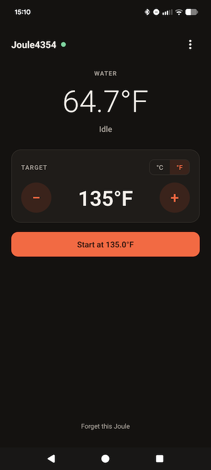

# OpenSousVide

Open-source unofficial app for controlling a ChefSteps Joule sous vide directly over
Bluetooth, without the official app, without any kind of account, and without
internet access.

(Not affiliated with, endorsed by, or sponsored by ChefSteps or Breville. The code in this repository is
provided as-is, with no warranty, etc. All trademarks belong to their respective owners.)

For your Android device, [download and install the APK](./release/opensousvide.apk)
(or build and install from source).

For your iOS device, I have not yet published the app on the App Store, so you
will need to build and deploy it yourself, for now. 

---
This builds on the reverse-engineering notes in
[mitchcapper/JouleUWP](https://github.com/mitchcapper/JouleUWP).

## Layout

- [`python/`](python): command-line app (`joule scan`, `pair`, `set`, `status`, `watch`, `stop`).
- [`mobile/`](mobile): React Native (Expo) app for Android and iOS.
- [`docs/PROTOCOL.md`](docs/PROTOCOL.md): the Joule's Bluetooth protocol.
- [`proto/`](proto): protobuf message definitions shared by both apps.

## License

MIT
